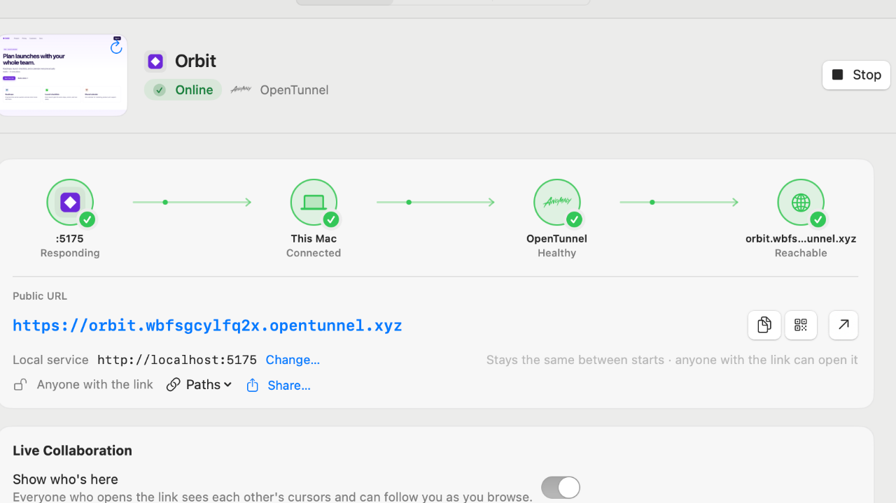

<p align="center">
  
</p>

<h1 align="center">OpenTraffic</h1>

<p align="center">
  <b>Share localhost. Collaborate live.</b><br>
  A macOS menu bar app that puts the dev server you're running on a public URL in one click,<br>
  then lets everyone who opens it point, comment, and follow along.
</p>

<p align="center">
  <a href="https://opentraffic.dev"><b>opentraffic.dev</b></a> ·
  <a href="https://opentraffic.dev/docs">Documentation</a> ·
  <a href="https://github.com/Medda-systems/OpenTraffic-releases/releases/latest">Download</a> ·
  <a href="#install">Install</a> ·
  <a href="#integrations-coding-agents-your-apps-webhooks">Coding agents</a>
</p>

<p align="center">
  
  
  <a href="https://github.com/Medda-systems/OpenTraffic-releases/releases/latest"></a>
  
</p>

<p align="center">
  
</p>

## Why OpenTraffic

<table>
  <tr>
    <td width="50%" valign="top">
      
      <h3>One click from localhost to a link</h3>
      Every web server running on your Mac shows up in the menu bar. Pick one, pick how to publish it — a temporary Cloudflare URL, a lasting OpenTunnel address, your tailnet, ngrok, or your own domain — and the link is on your clipboard.
    </td>
    <td width="50%" valign="top">
      
      <h3>Live collaboration on the real thing</h3>
      Everyone who opens the link sees each other's cursors, follows you as you browse, points at things, and pins comments to elements — with a picture, their browser, and the errors they hit.
    </td>
  </tr>
  <tr>
    <td width="50%" valign="top">
      
      <h3>Feedback your coding agent can act on</h3>
      Claude Code, Codex, Cursor, opencode, or any MCP client can share your server, wait for comments, fix what people point at, reply, and resolve — while you watch it happen on the page.
    </td>
    <td width="50%" valign="top">
      
      <h3>Every hop checked</h3>
      The connection path checks your server, this Mac, the tunnel, and the public URL, and offers the fix when something's off — like the Host header Vite and Next.js insist on.
    </td>
  </tr>
</table>

OpenTraffic has no account, analytics, or telemetry. Credentials stay in your Keychain, and it updates itself with releases signed by Medda Systems.

## Install

In Terminal:

```sh
curl -fsSL https://opentraffic.dev/install | sh
```

This downloads the latest release, checks its checksum and signature, and puts OpenTraffic in Applications ([`script/install.sh`](script/install.sh)).

With Homebrew:

```sh
brew tap medda-systems/tap
brew trust --cask medda-systems/tap/opentraffic
brew install --cask opentraffic
```

Homebrew asks you to trust casks from taps outside its official collection; the second line trusts just this one.

Or download it:

1. Download [`OpenTraffic.dmg`](https://github.com/Medda-systems/OpenTraffic-releases/releases/latest/download/OpenTraffic.dmg) (every version and its checksum are on the [releases page](https://github.com/Medda-systems/OpenTraffic-releases/releases)) and open it.
2. Drag **OpenTraffic** onto **Applications**.
3. Open OpenTraffic from Applications. Releases from the disk image or Homebrew aren't notarized by Apple yet, so the first launch is blocked:
   - **macOS 15 or later:** open **System Settings → Privacy & Security**, scroll down to the message about OpenTraffic, and click **Open Anyway**.
   - **macOS 14:** Control-click OpenTraffic in Applications, choose **Open**, then **Open** again.
4. Install `cloudflared` for Cloudflare shares, either with `brew install cloudflared` or from [Cloudflare's downloads](https://developers.cloudflare.com/cloudflare-one/connections/connect-networks/downloads/). Tailscale, ngrok, and OpenTunnel are optional.

OpenTraffic updates itself: it checks once a day, and **Check for Updates…** is in the app menu. Updates are signed with Medda Systems' key and verified before they're installed. Settings → General can turn the checks or background installs off.

The rest of this README covers how each part works in detail.

## Overview

The menu bar popover shows running tunnels as **Live** cards (favicon, URL, copy, QR code, stop; click a card to copy its URL), stopped ones under **Saved**, and a **Ready to Share** section of web servers detected on this Mac: **Share** creates and starts a Quick Tunnel in one step and copies its URL when it is ready. The menu bar icon is dimmed when nothing is shared, solid while something is live, blinks briefly when requests arrive, and gains a badge when something needs attention.

The main window has a sidebar (each tunnel shown with its site's favicon and a status badge) and, for each tunnel, an **Overview** tab and a **Logs** tab. Overview opens with a **connection path** — local service → this Mac → Cloudflare → public hostname — where each stage is lit by its health check, traffic animates along healthy links, and clicking a stage shows its detail and fix buttons. Below it are the public URL (copy, QR code for opening on a phone, open), the full health checklist, traffic metrics with a request sparkline and 2xx–5xx response classes, and technical details. Logs shows cloudflared's JSON output as a level label, a readable message, and key/value tags, with the raw JSON one click away; it has a level filter, search, and follow-tail.

Favicons are fetched from each local origin's own host only (never another host), size-limited, and cached in memory. New Quick Tunnel hostnames get a short grace period: OpenTraffic waits for the hostname to appear in public DNS before probing it, so macOS doesn't cache a premature "not found". **New Tunnel…** (⌘N) is a single sheet for all three kinds: Temporary URL, Your Domain, and Existing Tunnel (import). If Cloudflare isn't connected yet, the connection form appears inline.

### Shortcuts

| Shortcut | Action |
| --- | --- |
| ⌘N | New Tunnel |
| ⇧⌘I | Import from Cloudflare |
| ⌘⏎ | Start or stop the selected tunnel |
| ⇧⌘C | Copy the selected public URL |
| ⌘O | Open the public URL in the browser |
| ⌘R | Recheck health |
| ⌘1 / ⌘2 | Overview / Logs |
| Delete | Remove the selected tunnel (sidebar, with confirmation) |
| ⇧⌘T | Show the OpenTraffic window |

### Settings and first launch

On first launch (with no saved tunnels) a setup assistant checks for `cloudflared`, optionally connects a Cloudflare account, and sets preferences. It can be rerun from Help → Setup Assistant or General Settings. General Settings cover launch at login, Dock visibility (always, or only while the window is open), copying the public URL automatically, and notifications when a URL is ready or a tunnel needs attention. Notifications require running the bundled app.

## Requirements

- macOS 14 or newer
- `cloudflared` for Cloudflare shares
- Optional: the Tailscale app for tailnet shares, the `ngrok` CLI for ngrok shares, the `opentunnel` CLI (`brew install anomalyco/tap/opentunnel`) for OpenTunnel shares

OpenTraffic looks for these in `/opt/homebrew/bin`, `/usr/local/bin`, `/opt/local/bin`, and `~/.local/bin`, and for Tailscale also in the CLI inside `/Applications/Tailscale.app`. You can choose a different executable in Settings. Tailscale shares need the Tailscale app signed in, with HTTPS certificates turned on for the tailnet.

## Build from source

Building needs Swift 6.1 or later: Xcode 16.3+, or just its command line tools.

```sh
./script/build_and_run.sh
```

The script builds with SwiftPM, stages `dist/OpenTraffic.app`, stops any running OpenTraffic, and opens the new build. It also accepts `--verify`, `--debug`, `--logs`, `--telemetry`, and `--build-only`.

To build a release disk image:

```sh
./script/package_dmg.sh
```

This builds a universal (Apple silicon and Intel) release app, signs it, and writes `dist/release/OpenTraffic-<version>.dmg` with a `.sha256` checksum next to it. The version comes from the `VERSION` file.

- By default the app is signed ad hoc, which is free but Gatekeeper asks users to approve the first launch.
- With an Apple Developer ID, set `OPENTRAFFIC_SIGNING_IDENTITY="Developer ID Application: …"` to sign with the hardened runtime.
- Also set `OPENTRAFFIC_NOTARY_PROFILE` to the name of a `xcrun notarytool store-credentials` profile, and the disk image is notarized and stapled too.

It also writes `dist/release/appcast.xml`, the update feed, and signs both the feed and the disk image with the update key. That key is the "Private key for signing Sparkle updates" item (account `medda-systems`) in the release maintainer's Keychain; keep an exported copy somewhere safe, because installed copies only accept updates signed with it.

To publish a version: set `VERSION`, add its section to `CHANGELOG.md`, commit and push, then push a tag:

```sh
git tag -a v1.0.2 -m "OpenTraffic 1.0.2"
git push origin v1.0.2
```

The Release workflow (`.github/workflows/release.yml`) then builds and signs the release and runs `script/publish_release.sh`, which creates the public release in [Medda-systems/OpenTraffic-releases](https://github.com/Medda-systems/OpenTraffic-releases), with the disk image, its checksum, and the update feed, and updates the Homebrew cask in [Medda-systems/homebrew-tap](https://github.com/Medda-systems/homebrew-tap). It needs two repository secrets: `SPARKLE_PRIVATE_KEY` (the exported update key) and `RELEASES_TOKEN` (a fine-grained token with Contents read/write on those two repositories). The Tests workflow runs the test suite on every push to `main` and every pull request.

Run the test suite with:

```sh
SWIFTPM_MODULECACHE_OVERRIDE="$PWD/.build/module-cache" \
CLANG_MODULE_CACHE_PATH="$PWD/.build/module-cache" \
swift test --disable-sandbox
```

## Quick Tunnels

Click **Share** next to a detected server in the menu bar, or choose **New Tunnel… → Temporary URL**. The sheet scans this Mac for listening web services and preselects the newest one; detected services show their page title, process, port, HTTP status, and start time, followed by saved and discovered origins, and any URL can be typed instead. Connector processes (`cloudflared`) are never offered. **Start Sharing** saves and starts the tunnel; sharing a port that already has a saved Quick Tunnel reuses it instead of adding a duplicate. OpenTraffic captures the generated public URL and real connector logs. **Stop** sends graceful termination with a five-second drain period, retaining the saved definition. Starting it again normally creates a different public URL.

Quick Tunnels are intended for testing and development. They have Cloudflare's documented Quick Tunnel limitations and are not a production availability mechanism.

### Discovering Terminal-launched tunnels

OpenTraffic automatically scans at launch and about every five seconds for Quick Tunnels started outside the app by the same macOS user. Discovery uses the real `cloudflared` executable path, PID, process start time, and argument boundaries. It rejects named `run`, token, credential, and name-based connector forms. A candidate appears only after OpenTraffic confirms its process-specific loopback metrics endpoint returns a valid `*.trycloudflare.com` hostname.

Discovered tunnels appear in a separate **Running Elsewhere** section with their PID, origin when available, and public URL. OpenTraffic probes only loopback listener ports owned by that candidate process. It reads only the hostname from `/quicktunnel` and, when necessary, the HTTP(S) ingress service from `/config`; it never stores or displays the raw metrics configuration.

Managed and discovered rows expose the same context-menu actions (also on hover) for renaming, copying the current URL, opening the site, and viewing logs. Managed entries can be removed after confirmation. Discovered entries can be hidden without signaling their process and restored from General Settings. Discovered aliases persist for the same cloudflared executable and local origin across PID changes; **Use Current Hostname** removes an alias.

Row summaries use live process metrics when cloudflared exposes them: local port, process uptime, and total tunnel requests. Detail views additionally show origin-proxy errors, response-code counters, and QUIC transport bytes. QUIC byte counters include transport overhead and can be unavailable for HTTP/2 connectors. Missing metrics display as `—`; OpenTraffic never substitutes synthetic zeroes.

Another process's Terminal or pipe output is unavailable. When the command explicitly provides an absolute `--logfile` path that is a regular file owned by the same user, OpenTraffic shows only a bounded, redacted, read-only tail. It never consumes another process's stdout or stderr.

Stop, Remove, and Quit never affect discovered processes. **Manage in OpenTraffic** is an explicit conversion: after confirmation, OpenTraffic re-verifies the PID, start time, and live Quick Tunnel metadata, sends graceful termination without a force-kill, and starts a fresh app-owned Quick Tunnel for the same origin. The public URL changes.

The main management scene is a singleton. **Open OpenTraffic**, **View Logs**, and Window → **Show OpenTraffic** reveal and deminiaturize the existing window; a new instance is created only after the singleton has actually closed.

## Tailscale shares

**New Tunnel → Your Tailnet** (or **Share ▾ → Private on Your Tailnet** in the menu bar) shares a local server on this Mac's Tailscale name, `https://<mac>.<tailnet>.ts.net[:port]`. Each app gets its own HTTPS port; only the apps you pick are exposed. Private shares can be opened only by devices signed in to your tailnet. **Public on the internet (Funnel)** is available when Funnel is enabled for this device in the tailnet's access controls, and is limited to ports 443, 8443, and 10000.

Tailscale itself only proxies to `127.0.0.1`. When a server isn't reachable there — for example Vite/Node listening only on `::1`, or another machine on the LAN — OpenTraffic runs a small loopback TCP relay and points Tailscale at it; WebSockets and hot reload pass through unchanged.

Shares live in the Tailscale daemon, so OpenTraffic records exactly which port and target it applied (`tailscale-shares.json` in Application Support) and removes only those on Stop, Remove, and Quit, and on the next launch after a crash. It never runs `tailscale serve reset` and never changes a port that now points elsewhere. Shares created outside OpenTraffic are listed read-only in Settings → Tailscale, which also shows connection, HTTPS-certificate, and Funnel status with links to the admin console.

The first request on a new port can take around 20 seconds while Tailscale issues the HTTPS certificate; the health checks show this as in progress rather than failed.

## ngrok shares

**New Tunnel → ngrok** (or **Share ▾ → Public with ngrok**) shares a local server through your ngrok account. OpenTraffic reuses the authtoken already in ngrok's own config (`ngrok config add-authtoken …`) and never edits that file; Settings → ngrok shows whether the CLI and authtoken are present. Leave the domain empty to use your account's domain (free accounts get one permanent `*.ngrok-free.dev` domain, which OpenTraffic remembers so the URL is shown while stopped), or enter a reserved domain.

Each agent gets its own private inspection port, so OpenTraffic's agents never collide with each other or with ngrok started in Terminal. ngrok tunnels have a **Requests** tab (⌘3): every request with method, path, status, and duration; headers and bodies (JSON pretty-printed) with Authorization, Cookie, and API-key values hidden until revealed; **Replay**; and **Copy as cURL** (secrets left out). The Traffic card shows ngrok's request counts and 2xx–5xx classes from recent requests.

The free plan serves one ngrok share at a time on its domain; OpenTraffic refuses a second one up front and names the share that's running, and explains ngrok's own errors (missing authtoken, domain already online, unreserved domain) in plain language. Browser visitors on the free plan see an ngrok notice before your site; API clients and webhooks don't. ngrok agents started outside OpenTraffic are listed read-only in Settings → ngrok.

## OpenTunnel shares

**New Tunnel → OpenTunnel** (or **Share ▾ → Lasting Address with OpenTunnel**) shares a local server through [OpenTunnel](https://opentunnel.xyz), Anomaly's open-source tunnel.

How addresses work:
- This Mac gets one lasting address, `<id>.opentunnel.xyz`, and each share is a name in front of it, such as `https://orbit.<id>.opentunnel.xyz`.
- A share keeps its URL every time it starts, so a link you've sent keeps working.
- The first share creates the address, which takes a minute or two while its certificate is issued.
- TLS ends on this Mac, so OpenTunnel's relay can't read the traffic. There's no account.

How OpenTraffic manages it:
- OpenTunnel runs as a background service. OpenTraffic uses its own `opentraffic` profile for it, so routes you add yourself with `opentunnel route add` are never touched.
- Stopping a share removes its route, and the service stops when no routes are left.
- Quitting, and the next launch after a crash, clean up the same way.
- OpenTraffic never deletes the tunnel, so the address stays yours.

Requirements and limits:
- Only `http://` local addresses can be shared.
- OpenTunnel passes the public hostname to your server as-is, so Vite and similar dev servers reject it. **Fix Host Header** puts OpenTraffic's local proxy in front to send the local host instead.
- Live collaboration works the same as on Quick Tunnels.
- Anyone with the link can open a share, and the address shows up in public certificate logs. Shares can't be password-protected, so anything private should ask visitors to sign in itself.
- OpenTunnel is an early beta.

## Everyday sharing

- **Share button default.** Settings → General → *Share button uses* picks what a plain click on **Share** does: a temporary Cloudflare URL, a private tailnet share, or ngrok. The ▾ menu always offers all three, each marked with its provider's logo.
- **Auto-stop.** *Stop shares after* (15 min, 1 h, 4 h, or never) applies to new shares; **Stop After** in a tunnel's ⋯ menu changes a running one. A countdown shows in the header and on Live cards, and a notification says when time ran out.
- **Host header fix.** When Vite, Next.js, Django, or Rails reject the public hostname, the Public site check says so and offers **Fix Host Header**, which makes the tunnel send the local host (e.g. `localhost:5173`): `--http-host-header` for Quick Tunnels, an `add-headers` policy for ngrok, and `originRequest.httpHostHeader` on the Cloudflare route for custom domains. **Config Snippet…** shows the framework setting instead; Tailscale shares can only use the snippet.
- **Saved paths and sharing.** **Paths** copies the public URL plus a saved path such as `/api/webhooks/stripe`; **Share…** opens the macOS share sheet.
- **Notification actions.** "Is live" notifications have **Copy URL** and **Stop**; failures have **Show Details**.

## Automation

- **Keep-alive.** Tunnels whose connector exits unexpectedly restart after 2 s, 10 s, then 30 s, and OpenTraffic gives up after three restarts in ten minutes. ngrok account and plan errors aren't retried.
- **Auto-start.** *Start automatically when … is running* (Edit sheet) starts a tunnel as soon as its local server answers. After you stop it, it stays stopped until the server goes away and comes back.
- **Projects.** Give tunnels the same project name to start and stop them together from the sidebar, the menu bar, or links.
- **Global shortcuts** (opt-in): ⌃⌥⌘S shares the newest local server; ⌃⌥⌘C copies the latest tunnel's URL.
- **Links and the `opentraffic` command.** `opentraffic://share?port=3000&via=tailscale`, `start?name=`, `stop?name=` / `stop?all`, `copy?name=`, `show`, and `project?name=…&action=start|stop` control OpenTraffic from scripts, Raycast/Alfred, or Shortcuts' *Open URLs* action. Settings → General installs the bundled `opentraffic` command (`opentraffic share 3000 --via ngrok`, `opentraffic copy Docs`, `opentraffic stop --all`, …) as a symlink. Because any app or web page can open a `opentraffic://` link, links that share or start something ask for confirmation unless *Allow automation without confirmation* is on.

## Protected shares

**Protection…** (⇧⌘P, or the lock chip under the public URL) chooses who can open a share:

- **ngrok:** a password (username plus a generated password kept in the Keychain, never in the tunnels file; **New Password** locks out the old one), or sign-in with Google or GitHub through ngrok's managed apps, optionally limited to listed email addresses.
- **Custom domains:** sign-in with an emailed one-time code through a Cloudflare Access application for the hostname, limited to listed email addresses. This needs a Zero Trust organization and the API token permission *Account → Access: Apps and Policies → Edit*; Settings → Cloudflare shows whether the token can read Access. Turning protection off deletes the application; removing the tunnel from OpenTraffic leaves it in place.
- **Tailscale** private shares are already limited to your tailnet; **Quick Tunnels** and public Funnel shares can't be protected.

Health checks treat a sign-in wall as reachable rather than failed.

## Live collaboration

Turn on **Live collaboration** for a temporary share (in New Tunnel, the share's detail view, or `opentraffic share 5173 --collab`) and everyone who opens the link sees each other: a presence pill with names, live cursors anchored to page elements, and — after **Open as Host** — a **Lead** switch that brings everyone to the page and scroll position you're on.

People can also pin **comments** to any element (the Comment button in the pill) and **point** at things for everyone (the Point button, or ⌥-click). Comments appear in the share's **Feedback** tab (⌘4), where you can resolve or delete them for everyone and copy them as Markdown or as a GitHub issue; they're kept between sessions. OpenTraffic can notify you when someone joins or comments, and shows your name from Settings → General → Live Collaboration to the people you share with.

OpenTraffic runs a small proxy on 127.0.0.1 between cloudflared and your dev server. It forwards everything unchanged, with two exceptions:
- HTML pages get two script tags, `/__opentraffic/bridge.js` and `/__opentraffic/collab.js`.
- OpenTraffic answers `/__opentraffic/*` itself.

Hot-reload WebSockets are relayed byte for byte. The hub lives in OpenTraffic, with no account or outside service.

What visitors share:
- Everyone sees each other's chosen names and cursors, and which page (path only, never the query string) they're on.
- Page content and form fields are never sent.
- When someone pins a comment, it carries a short label of the element, the page title, a picture of the element (with text fields blanked), their browser and window size, and, if you turned on error collection, the browser errors they hit.

Live collaboration works with Quick Tunnel and OpenTunnel shares of `http://` addresses. See [specs/collab-plan.md](specs/collab-plan.md) for the protocol.

### Sharing apps made of several local services

Many apps call other local services directly — an API on `localhost:3001`, a realtime server on `ws://localhost:7880`. Through a tunnel those addresses would point at each visitor's own computer. With live collaboration on, OpenTraffic's **localhost bridge** sends such calls through the same share instead: the first time the app tries to reach another port, the share's Live Collaboration card asks **Allow localhost:7880?**, and from then on visitors' browsers reach it at `/__opentraffic/port/7880/` on the share. The proxy also keeps redirects and `localhost` cookies on the share, and adjusts a strict Content-Security-Policy only so OpenTraffic's own scripts load. Limits: sign-in providers only return to callback URLs the app registered (usually `localhost`), and WebRTC media can't go through a tunnel.

### Richer feedback

Comments carry a picture of the pinned element, the visitor's browser and window size, and — when **Collect browser errors from visitors** is on — the errors they ran into. Threads can be answered from the page, from the Feedback tab, or by an app through the API.

## Integrations: coding agents, your apps, webhooks

Turn on **Settings → Integrations → Allow apps on this Mac to use OpenTraffic** to run a local API on `127.0.0.1:47777`. It's bearer-token protected and refuses requests from web pages.

- **Coding agents (MCP):** Claude Code, Codex, Cursor, opencode, and any MCP client can share a dev server, wait for feedback, reply, and resolve comments. Settings shows the exact setup for each; the bridge is `OpenTraffic.app/Contents/MacOS/opentraffic-mcp`. A Claude Code plugin with a ready-made skill is in [`Integrations/claude-code`](Integrations/claude-code).
- **Your apps:** a REST API (`/v1/shares`, `/v1/shares/{share}/comments`, `/v1/events` long polling, …) for turning feedback into tickets.
- **Webhooks:** share, session, comment, and error events POSTed as signed JSON.

See [Integrations/README.md](Integrations/README.md) for commands, endpoints, and signature verification. Publishing a share through the API asks first unless allowed in Settings.

## Cloudflare account setup

Open Settings → Cloudflare (or pick Your Domain / Existing Tunnel in New Tunnel, which shows the same form inline) and enter:

1. The Cloudflare account ID.
2. A scoped API token. OpenTraffic stores it in the macOS Keychain, never in preferences or the tunnel JSON file.

Create a scoped API token with exactly these permission rows:

- Account → Cloudflare Tunnel → Edit
- Zone → Zone → Read
- Zone → DNS → Edit

Scope the token to the selected account and only the zones OpenTraffic should manage. Tunnel Edit covers listing, importing, connector-token retrieval, and creating the supported remotely managed tunnels.

The Existing Tunnel view reads the existing remote ingress configuration and leaves it unchanged. Locally configured tunnels (`config_src: local`) are shown as unsupported because starting them correctly depends on their existing YAML and credentials outside OpenTraffic.

When OpenTraffic rewrites a tunnel's route (Finish Setup, a changed local URL, or the Host header fix), it keeps every other rule exactly as it was, including their `originRequest` and `path` settings and config-level settings such as `warp-routing`, and leaves path-specific rules for the same hostname alone.

The Your Domain view performs three explicit Cloudflare operations: create the remote tunnel, install a hostname/local-service ingress rule with a final `http_status:404` catch-all, and create a proxied CNAME. The hostname is entered as a subdomain plus a zone picker, so it always belongs to the chosen zone (an empty subdomain serves the zone apex). The form checks the local service and the DNS record while typing. Local URLs with a path are rejected up front because Cloudflare ingress rules cannot proxy to a path; a trailing slash is normalized away. Creation shows per-step progress, checks for a conflicting DNS record before creating the tunnel (creation is blocked while one exists), and offers **Start Now** on success. A DNS record that already points at the same tunnel is accepted; a record that points anywhere else is reported as a conflict and OpenTraffic never overwrites it. If configuration or DNS setup fails after tunnel creation, the app retains the new tunnel ID as an imported entry and reports it for recovery. The detail view's **Finish Setup** action (shown in a Setup incomplete banner and on a failed DNS check) re-applies the saved hostname's ingress rule and DNS record, keeping ingress rules for other hostnames, so a half-created tunnel can be completed without creating a duplicate.

When the Your Domain form opens, it captures the currently selected managed or discovered HTTP(S) origin once (falling back to the newest detected server) and offers all saved/discovered origins in a picker. With neither, the URL starts blank; OpenTraffic never silently substitutes `localhost:3000`. The first Create click performs a bounded HEAD reachability check. If the origin does not answer, Cloudflare creation remains blocked until the user explicitly chooses **Create Anyway**.

Account refresh also reads each saved remote tunnel's current configuration. OpenTraffic matches only the ingress with the saved hostname and synchronizes its displayed local service/hostname metadata, so dashboard-side repairs appear locally without rewriting or flattening any remote configuration.

While an app-owned connector is running, OpenTraffic also resolves its effective origin directly from that process's loopback `/config`. It verifies the connector PID and start time, the runtime generation, and ownership of the exact listening metrics port before and after the read. Named tunnels require one unambiguous service for the exact saved hostname; Quick Tunnels require one unambiguous applicable service. Ambiguous configurations never overwrite saved intent. A verified live origin is persisted separately as last-known metadata, so stopped or locked-account views remain accurate and clearly label the source/freshness. Rows, details, previews, and the Create origin picker all use this same resolved origin.

## Security and lifecycle

- API tokens live in Keychain under the owning account ID.
- Connector tokens are fetched only when starting, passed through `TUNNEL_TOKEN` in the child environment, and never persisted or placed in process arguments.
- Inherited `TUNNEL_*` and `CLOUDFLARED_*` variables are removed from the child environment.
- Each child uses an app-owned empty YAML configuration so a user's default Cloudflare configuration cannot change the command.
- Logs are bounded, redact labeled credentials and the exact connector token, and default to `info` level.
- OpenTraffic controls only processes it started. Stop and Quit terminate those child connectors; they do not stop a Cloudflare tunnel globally or affect connectors on other machines.
- If OpenTraffic crashes or is force-quit, connectors it started can outlive it. On the next launch it stops them, matching only processes whose arguments reference OpenTraffic's private per-run config folder and whose parent has exited, re-verified by PID and start time. Quitting (including SIGTERM from `script/build_and_run.sh`) stops connectors normally.

Cloudflare credentials are cached only for the current app session. Tokens saved in the standard macOS Keychain unlock automatically when the app launches, with no prompt, and OpenTraffic refreshes the account right away. Touch ID-protected tokens still ask for authentication every session. Background status refresh uses the in-memory cache or a noninteractive Keychain query and never opens an authorization prompt. **Unlock / Connect** performs a manual Keychain authorization when automatic unlock is unavailable. A manual authorization can also be needed after a rebuild changes the app's ad-hoc signature; signing with a stable identity (`OPENTRAFFIC_SIGNING_IDENTITY`) avoids that. Newly created Keychain items request Data Protection Keychain user-presence access control, which uses Touch ID with the system-password fallback where the signing environment supports it. Existing items are never automatically deleted or recreated.

Builds are ad-hoc signed unless you set a signing identity. The build script gives the bundle a stable identifier, but an ad-hoc code hash still changes between builds, so macOS may require one legacy-Keychain authorization after a rebuild. Stable cross-build trust needs a proper installed signing identity. Data Protection Keychain user-presence items additionally need the application identifier, Keychain capability, and suitable provisioning/entitlements. The build accepts user-provided `OPENTRAFFIC_SIGNING_IDENTITY`, `OPENTRAFFIC_ENTITLEMENTS_PATH`, and `OPENTRAFFIC_PROVISIONING_PROFILE_PATH`; it validates and embeds the supplied profile before signing and never invents or downloads these values. OpenTraffic reports invalid/ad-hoc signing or missing capability rather than silently storing a token with weaker protection.

Touch ID–protected storage requires paid Apple Developer Program signing and provisioning, so Settings hides the Token Storage section unless the running build supports it (or a token is already stored that way); tokens otherwise use the standard Keychain. After a properly signed/capable build is running, Token Storage offers an explicit migration for an already unlocked legacy token. Migration creates a Data Protection Keychain `userPresence` record, verifies an authorized read, commits a protected-only preference marker, and only then removes the legacy item. Cancellation or verification failure preserves the legacy source. If legacy cleanup fails after commit, it remains only as an ignored backup; temporary protected-backend failure never falls back to it.

## Site previews

The detail header previews the site's local HTTP(S) origin using an isolated `WKWebView` with a nonpersistent website data store. OpenTraffic does not reuse browser cookies or history, submit forms, click controls, or authenticate. Top-level navigation is limited to the origin host, authentication challenges are cancelled, capture concurrency is one, and loading is bounded by a timeout. A failed refresh keeps the last cached preview.

Snapshots use a fixed 1440×900 master viewport and proportional Retina small, medium, and large derivatives with aspect-fill cropping. The local Application Support preview cache is bounded to 50 MB. Managed previews are keyed by tunnel UUID and removed with the saved tunnel; discovered previews use the stable executable-and-origin preference identity.

## Current boundaries

OpenTraffic does not delete Cloudflare tunnels or DNS records. “Remove from OpenTraffic” only stops the app-owned connector and deletes the local saved entry. Remote status is account-wide and can remain Healthy after this app stops its connector if another connector is active. The logs view shows `cloudflared` connector output; it is not an origin application console or a synthetic per-request access log.

## Privacy and data

OpenTraffic has no analytics, telemetry, or account of its own. It only connects to:

- **Your own servers:** the local servers you share. It checks the ones listening on this Mac to show page titles and favicons, and it skips well-known database ports.
- **Cloudflare:**
  - `api.cloudflare.com`, only when you connect a Cloudflare account.
  - `cloudflare-dns.com` (DNS over HTTPS), to see whether a new public hostname resolves yet.
  - Your shares' public URLs, for health checks.
- **GitHub:** once a day, to check `github.com/Medda-systems/OpenTraffic-releases` for updates (you can turn this off in Settings → General).
- **The connectors it runs:** `cloudflared`, `tailscale`, `ngrok`, and `opentunnel` each talk to their own service. OpenTunnel keeps its own files in `~/.config/opentunnel`, `~/.local/share/opentunnel`, and `~/.local/state/opentunnel` (OpenTraffic's are the `opentraffic` profile).

Where it keeps things:

- **Settings:** in the app's preferences (`se.medda.opentraffic`).
- **Saved shares, comments, and screenshots:** in `~/Library/Application Support/OpenTraffic/`. Site previews are cached there too, up to 50 MB.
- **API token:** the local API's token is in `~/Library/Application Support/OpenTraffic/api-token`, readable only by you.
- **Keychain:** Cloudflare API tokens are under the service `com.tunnelbar.app`, ngrok share passwords under `com.tunnelbar.share-password` (names from when the app was called TunnelBar), and webhook signing secrets under `se.medda.opentraffic.webhook-secret`.

To uninstall:
1. Quit OpenTraffic and delete it from Applications.
2. Delete `~/Library/Application Support/OpenTraffic` and `~/Library/Preferences/se.medda.opentraffic.plist`.
3. Remove the Keychain items above with Keychain Access.
4. If you installed the `opentraffic` command, delete `/usr/local/bin/opentraffic`.

## License

OpenTraffic is made by Medda Systems and released under the [MIT License](LICENSE). It's built on SwiftNIO and other Apple open-source packages under the Apache License 2.0; see [THIRD_PARTY_NOTICES.md](THIRD_PARTY_NOTICES.md). The release app includes these notices in `OpenTraffic.app/Contents/Resources/Licenses`.

OpenTraffic is an independent project and isn't affiliated with or endorsed by Cloudflare, Tailscale, or ngrok. Their names and logos are trademarks of their owners. The provider marks come from [Simple Icons](https://simpleicons.org) (CC0) and only identify each service.

The app icon's master is `Assets/opentraffic-app-icon.png` (1024 × 1024); `script/generate_icons.sh` turns it into `Assets/OpenTraffic.icns`.
