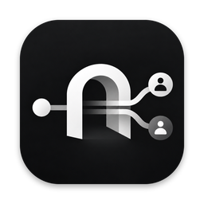
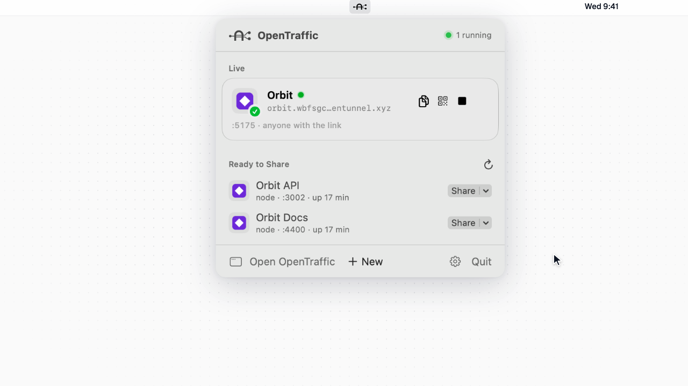
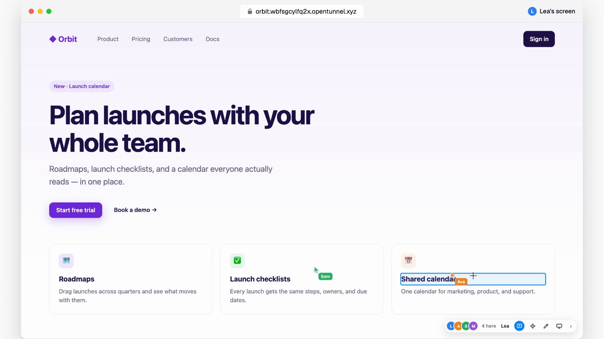
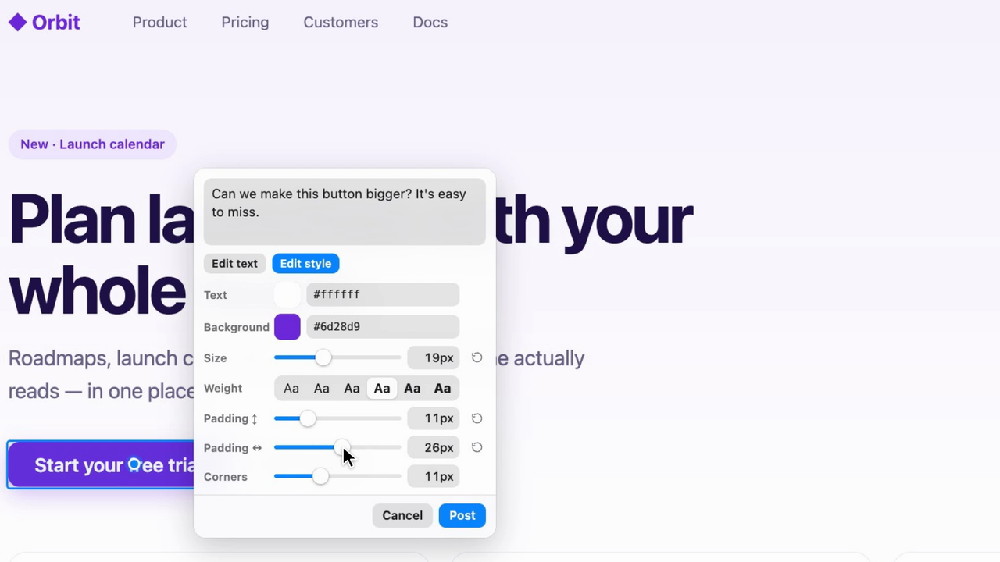
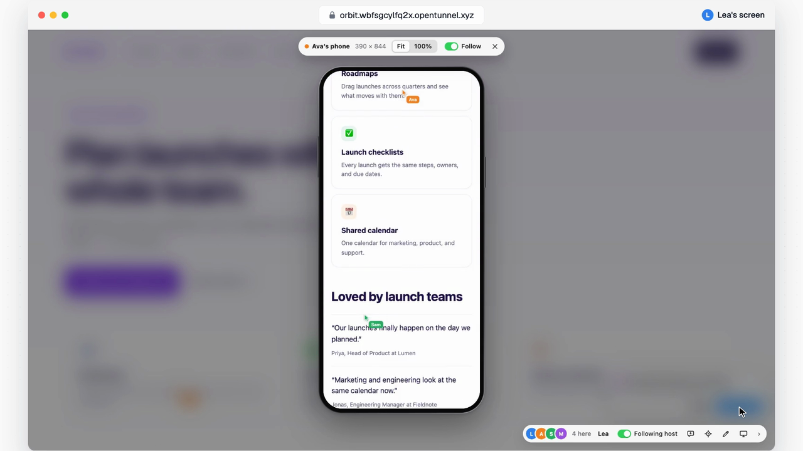
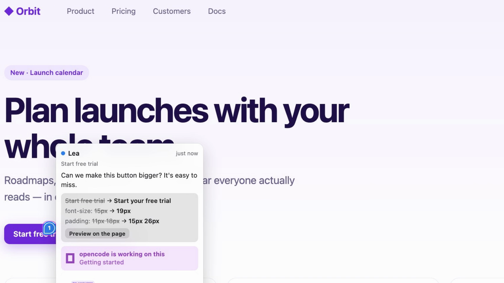

<div align="center">



# OpenTraffic

**Share localhost. Collaborate live.**

A macOS menu bar app that puts your dev server on a public URL in one click,<br>
then lets everyone who opens it point, comment, and follow along.

[Website](https://opentraffic.dev) · [Documentation](https://opentraffic.dev/docs) · [Download](https://github.com/Medda-systems/OpenTraffic-releases/releases/latest) · [Changelog](CHANGELOG.md)

[](https://github.com/Medda-systems/OpenTraffic-releases/releases/latest)

[](LICENSE)

</div>

<br>

https://github.com/user-attachments/assets/00eb4fc0-341c-45c6-a664-2b6b361f3a1b

<br>

## Why OpenTraffic

You're running something on `localhost:5173` and want someone to look at it. OpenTraffic finds it, gives it a link, and turns that link into a shared session: the people you send it to see each other's cursors, pin comments to the exact element they mean, and your coding agent can read those comments and fix them.

No config files, no account, no telemetry.

<br>

## Highlights

### One click from localhost to a link

Every web server on your Mac shows up in the menu bar. Share it on a temporary Cloudflare URL, a lasting OpenTunnel address, your tailnet, ngrok, or your own domain, and the link is on your clipboard.

<p align="center"></p>

<br>

### Live collaboration on the real thing

Everyone who opens the link sees each other's cursors and can follow you as you browse. They point, draw, and pin comments to an element or an area, with a picture of it, their browser, and the errors they ran into.

<p align="center"></p>

<br>

### Suggest the exact change

Change the text, colours, size, or spacing right on the page, with a palette and sliders. The comment carries the exact change, old to new, so nobody has to guess.

<p align="center"></p>

<br>

### See it on their phone

Everyone's device shows up. View the page at anyone's exact size and comment inside it, or lead with your phone open and everyone following sees it too.

<p align="center"></p>

<br>

### Feedback your coding agent can act on

Claude Code, Codex, Cursor, opencode, or any MCP client can share your server, read the comments with the exact change and the element's source file, fix them, reply, and resolve them. Each fix is its own commit on a branch, and only people you trust can start a run.

<p align="center"></p>

<br>

### And also

- **Protection:** a password on any temporary, OpenTunnel, or ngrok share (with a link that has it built in), Google/GitHub sign-in on ngrok, email sign-in on your own domain.
- **Who can do what:** per person, trusted, can comment, or view only.
- **Every hop checked:** your server, this Mac, the tunnel, and the public URL, with the fix when something's off.
- **Apps made of several servers:** calls to an API on another port go through the same share.
- **Stays out of your way:** auto-stop timers, projects that start together, notifications, and global shortcuts.
- **Signed and notarized:** releases come from Medda Systems and update themselves.

<br>

## Get started

**1. Install**

```sh
curl -fsSL https://opentraffic.dev/install | sh
```

<details>
<summary>Other ways to install</summary>

<br>

**Homebrew**

```sh
brew tap medda-systems/tap
brew trust --cask medda-systems/tap/opentraffic
brew install --cask opentraffic
```

**Disk image:** [download OpenTraffic.dmg](https://github.com/Medda-systems/OpenTraffic-releases/releases/latest/download/OpenTraffic.dmg) and drag OpenTraffic into Applications.

</details>

**2. Pick how to share.** The first time OpenTraffic opens, it offers the tools it shares through (Cloudflare, OpenTunnel, ngrok, Tailscale), each one click to install from its maker's official release, checked before it's installed.

**3. Share.** Click the menu bar icon and press **Share** next to your dev server. That's it.

> Needs macOS 14 or later, on Apple silicon or Intel. See the [installation guide](https://opentraffic.dev/docs/installation) for details.

<br>

## Ways to share

| Provider | Address | Who can open it | Account |
| --- | --- | --- | --- |
| **Cloudflare** | Temporary `*.trycloudflare.com` | Anyone with the link | None |
| **OpenTunnel** | Lasting `*.opentunnel.xyz` | Anyone with the link | None |
| **Tailscale** | Your Mac's tailnet name | Your tailnet, or anyone through Funnel | Tailscale |
| **ngrok** | Your ngrok domain | Anyone, or behind a password or sign-in | ngrok |
| **Your domain** | A hostname on your Cloudflare zone | Anyone, or behind email sign-in | Cloudflare |

Live collaboration works on Cloudflare temporary URLs and OpenTunnel. [Compare them in detail](https://opentraffic.dev/docs/providers).

<br>

## Terminal and coding agents

The `opentraffic` command comes with the app and does everything its windows do.

```sh
opentraffic services                         # web servers running on this Mac
opentraffic share 5173 --collab              # share one, with live collaboration
opentraffic comments orbit                   # what people said
opentraffic reply orbit 3 "Fixed, reload."   # answer them
```

Teach your coding agent to use it:

```sh
curl -fsSL https://opentraffic.dev/skill | sh
```

Prefer MCP, a REST API, or webhooks? See [Integrations](https://opentraffic.dev/docs/mcp).

<br>

## Documentation

- [Quick start](https://opentraffic.dev/docs/quickstart)
- [Live collaboration](https://opentraffic.dev/docs/collaboration) and [feedback](https://opentraffic.dev/docs/feedback)
- [Command line](https://opentraffic.dev/docs/cli), [agent skill](https://opentraffic.dev/docs/agent-skill), [MCP](https://opentraffic.dev/docs/mcp), and [REST API](https://opentraffic.dev/docs/rest-api)
- [Privacy](https://opentraffic.dev/docs/privacy), [security](https://opentraffic.dev/docs/security), and [troubleshooting](https://opentraffic.dev/docs/troubleshooting)

<br>

## Contributing

Bug reports, ideas, and pull requests are welcome. To build and test:

```sh
./script/build_and_run.sh        # builds dist/OpenTraffic.app and opens it
swift test --disable-sandbox     # runs the tests
```

You'll need Swift 6.1 or later (Xcode 16.3+ or its command line tools). [CONTRIBUTING.md](CONTRIBUTING.md) explains the project layout and how releases are made. Please report security issues privately, as described in [SECURITY.md](SECURITY.md).

<br>

## License

OpenTraffic is © Medda Systems AB and released under the [MIT License](LICENSE). The OpenTraffic name and logo are trademarks of Medda Systems AB and aren't covered by the license; see [TRADEMARKS.md](TRADEMARKS.md). Third-party components are listed in [THIRD_PARTY_NOTICES.md](THIRD_PARTY_NOTICES.md).

OpenTraffic isn't affiliated with Cloudflare, Tailscale, ngrok, Anomaly, Anthropic, Anysphere (Cursor), or OpenAI; their names and logos belong to their owners.
